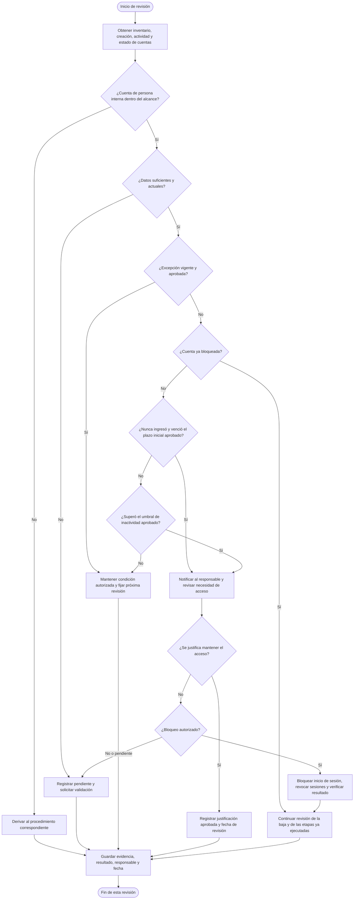
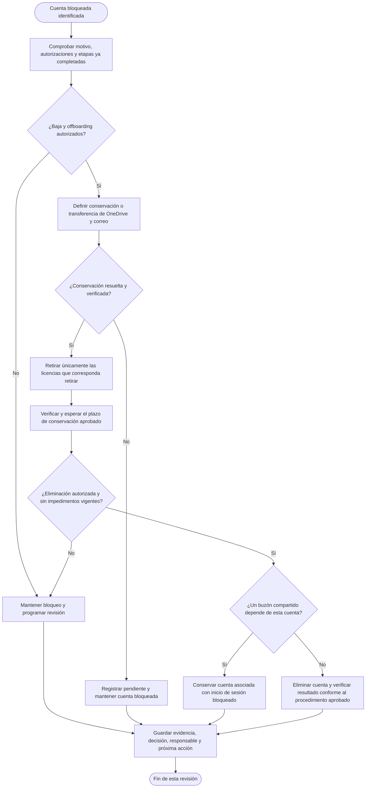
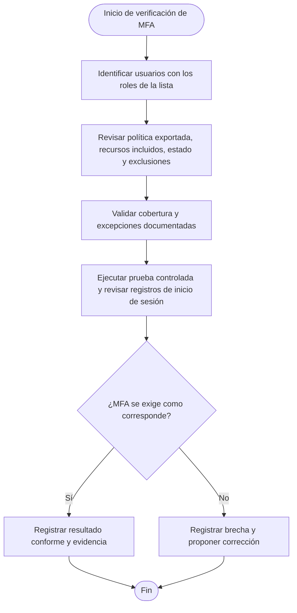

# Flujo de revisión de cuentas y control de MFA

**Borrador para revisar con Franco · 28 de octubre de 2026**

El objetivo es convertir la documentación y el esquema mostrado en la reunión en decisiones verificables. Este borrador distingue la gestión de cuentas por inactividad del control de MFA para roles administrativos. Los plazos y autorizaciones pendientes deben confirmarse antes de implementar el flujo.

## Alcance del flujo de cuentas

La reunión propuso comenzar por cuentas internas de personas y dejar los invitados externos para una segunda etapa. El campo `userType` ayuda a distinguir Member y Guest, pero debe confirmarse también la relación de la persona con Austranet y el propósito de la cuenta. Las cuentas de servicio, de emergencia y asociadas a buzones compartidos requieren tratamiento específico.

Este diagrama cubre cuentas nuevas sin primer acceso y cuentas potencialmente inactivas. Un cese laboral o contractual confirmado debe seguir la revocación inmediata definida por los procedimientos, sin esperar a cumplir un umbral de inactividad.

## Diagrama de revisión y bloqueo

La salida hacia la baja debe registrar el motivo y la fecha del bloqueo. Una excepción no equivale a ignorar la cuenta: requiere responsable, aprobación y próxima revisión.

## Diagrama de baja y eventual eliminación

La conversión del correo a buzón compartido, cuando se acuerde esa opción, debe efectuarse antes de retirar su licencia. Microsoft indica que la cuenta asociada es necesaria para mantener el buzón compartido. Su tamaño y características pueden requerir conservar licencias. Por eso la eliminación de la cuenta no puede ser el resultado automático de toda baja. [Microsoft: convertir un buzón de usuario en compartido](https://learn.microsoft.com/microsoft-365/admin/email/convert-user-mailbox-to-shared-mailbox).

La conservación o transferencia de datos debe quedar resuelta antes de retirar las licencias correspondientes. El plazo real depende del servicio y de la configuración aplicable; los 60 días anotados en la imagen no constituyen una regla general de Microsoft para borrar usuarios. [Microsoft: baja de un empleado](https://learn.microsoft.com/en-us/microsoft-365/admin/add-users/remove-former-employee?view=o365-worldwide), [Microsoft: cuentas OneDrive sin licencia](https://learn.microsoft.com/en-us/sharepoint/unlicensed-onedrive-accounts).

## Plazos que deben confirmarse

| Situación | Lo que tenemos | Decisión pendiente |
| --- | --- | --- |
| Cuenta creada que nunca inició sesión | PRO-07 pide confirmar necesidad o eliminar/deshabilitar; fija 5 días hábiles para resolver. En la reunión se interpretó como bloqueo tras 5 días desde la creación. | Definir desde qué evento se cuentan los días, si son hábiles y qué aprobación permite bloquear. Hasta entonces, el diagrama usa un plazo inicial aprobado sin fijar su valor. |
| Cuenta sin actividad | PRO-06 indica revisar cuentas con más de 60 días de inactividad y deshabilitar/eliminar si no se justifican. | Confirmar dato de actividad, excepciones, notificación y aprobación del bloqueo. |
| Revisión periódica | PRO-07 fija cada 45 días. PRO-06 establece mínimos semestrales para cuentas privilegiadas/críticas y anuales para las demás, salvo mayor frecuencia por riesgo. | Confirmar cómo se relacionan las revisiones y qué periodicidad aplicará al control. |
| Tiempo después del bloqueo | La imagen propone el día 60 para validar una eliminación; la reunión lo presenta como una cifra por definir. | Aprobar plazo, evento de inicio, responsables y condiciones de conservación y eliminación. |

La detección diaria por una automatización puede coexistir con una revisión formal periódica; deben documentarse por separado.

Para evaluar actividad, Microsoft distingue el último intento de inicio de sesión del último acceso exitoso. La falta de un valor no basta para concluir que una cuenta nunca fue utilizada: deben revisarse disponibilidad de los datos, fecha de creación y registros. [Microsoft: investigar cuentas inactivas](https://learn.microsoft.com/en-us/entra/identity/monitoring-health/howto-manage-inactive-user-accounts).

## Control de MFA para roles administrativos

La lista enviada identifica los roles que deben comprobarse en la política mostrada. No demuestra por sí misma que MFA esté exigido ni que todos los usuarios con privilegios estén cubiertos. Deben comprobarse asignaciones, alcance, estado de la política, excepciones y resultados de autenticación.

Una política en modo de solo informe registra el resultado esperado, pero no exige el control. Microsoft describe la validación y posterior activación de estas políticas en su [guía de MFA para administradores](https://learn.microsoft.com/en-us/entra/identity/conditional-access/policy-old-require-mfa-admin).

### Roles aportados

1. Authentication Administrator
2. Authentication Policy Administrator
3. Billing Administrator
4. Conditional Access Administrator
5. Exchange Administrator
6. Exchange Recipient Administrator
7. External ID User Flow Administrator
8. External ID User Flow Attribute Administrator
9. Global Administrator
10. Helpdesk Administrator
11. Privileged Authentication Administrator
12. Security Administrator
13. Service Support Administrator
14. SharePoint Administrator
15. User Administrator

Se corrigió únicamente la escritura de “Privileged Authetication Administrator” a “Privileged Authentication Administrator”. La lista conserva los 15 roles enviados; cualquier ampliación de cobertura debe validarse con Franco.

Las cuentas de emergencia deben tratarse explícitamente: Microsoft recomienda protegerlas con autenticación resistente al phishing y mantenerlas fuera de la depuración automática por inactividad. Esto no significa dejarlas sin protección ni sin monitoreo. [Microsoft: cuentas de acceso de emergencia](https://learn.microsoft.com/en-us/entra/identity/role-based-access-control/security-emergency-access).

## Información de entrada y evidencia de salida

**Datos que hay que solicitar o confirmar:** identificador de la cuenta, nombre de usuario, tipo Member/Guest, propósito, responsable, estado habilitado/bloqueado, fecha de creación, actividad de inicio de sesión, roles, excepción vigente y fechas de bloqueo y de acciones de baja. Debe verificarse qué campos contiene realmente la exportación entregada.

**Evidencia por cada decisión:** requisito y documento de origen, cuenta revisada, fecha y fuente del dato, criterio aplicado, resultado, aprobación, acción realizada y comprobación posterior. Si falta información, registrar pendiente de validación, sin inventar el estado de cumplimiento.

## Preguntas para validar este borrador con Franco

1. ¿La regla de cuentas nuevas se cuenta desde la creación, desde la fecha de incorporación o desde que se detecta el caso? ¿Son cinco días hábiles?
2. ¿Qué dato de actividad usaremos y cómo trataremos las cuentas sin datos de inicio de sesión?
3. ¿Quién justifica mantener una cuenta y quién autoriza bloquearla, reactivarla o eliminarla?
4. ¿Qué cuentas de servicio, emergencia y buzones compartidos tendrán tratamiento separado?
5. ¿El bloqueo por inactividad inicia siempre una baja o primero se valida que la persona ya no necesita su cuenta?
6. ¿Qué conservación de OneDrive y correo está aprobada y qué licencias deben mantenerse?
7. ¿Qué plazo aplicará a las cuentas bloqueadas y qué evento inicia ese plazo?
8. ¿La política MFA está activa, qué recursos cubre y qué excepciones tiene? ¿Los 15 roles enviados representan todo el alcance acordado?

## Fuentes de trabajo

- Imagen del flujo enviada por el usuario y lista de roles MFA.
- Transcripción de la reunión del 28 de octubre de 2026: `Transcripcion_reunion_Austranet_2026-10-28.txt`.
- Documentos de Grupo 1: SGSI-POL-03, SGSI-POL-04, SGSI-PRO-02, SGSI-PRO-06 y SGSI-PRO-07.
- Documentación de Microsoft enlazada en las secciones correspondientes, consultada el 28 de octubre de 2026.
