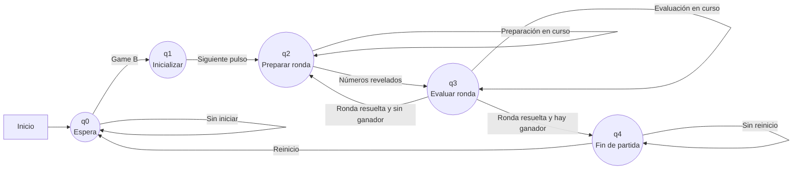
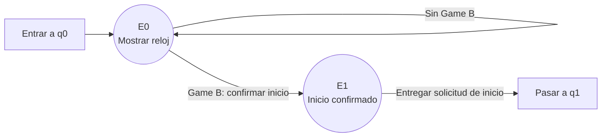
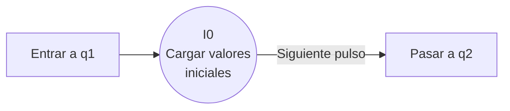
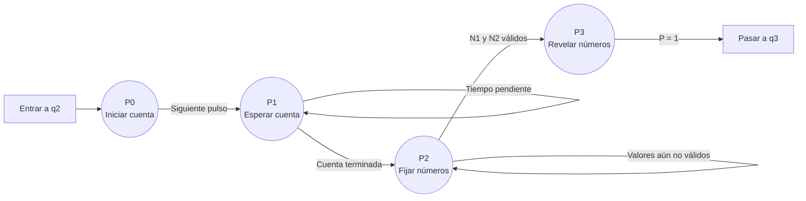
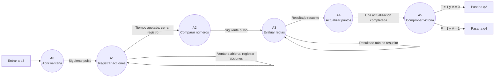
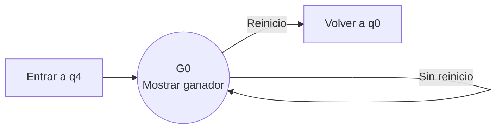

# Judge — Estados y diagramas del autómata

Propuesta de diseño basada en la sección 3.3 del [informe de Judge](../INFORME_GAME_AND_WATCH_JUDGE.md). Fecha: 28 de octubre de 2026.

## Cómo leer los diagramas

- **Círculo:** un estado, es decir, una situación que el sistema recuerda.
- **Flecha:** un cambio de estado.
- **Texto de la flecha:** condición necesaria para realizar ese cambio.
- **Flecha que vuelve al mismo círculo:** el sistema sigue esperando o trabajando en ese estado.
- **Inicio:** indica por dónde entra el sistema; no es un sexto estado.

Esta versión considera únicamente jugador 1 contra jugador 2, ambos humanos, iniciando con Game B. La máquina principal tiene cinco estados. Cada fase tiene además un diagrama de detalle propuesto. Los estados internos de una fase no se deben confundir con los cinco estados del controlador principal.

No se usa doble círculo para Game Over: este es un controlador que sigue funcionando y espera reinicio, no un autómata reconocedor de palabras con estados de aceptación.

## 1. Autómata general: las cinco fases

**Reinicio global:** se propone que un reset desde cualquier estado regrese a q0 y tenga prioridad sobre todas las demás condiciones. Para mantener legible el dibujo, solo se representa esa flecha desde q4; la tabla siguiente sí incluye el caso global. Reiniciar deja el juego en espera; presionar Game B vuelve a iniciar una partida.

### Qué hace cada estado

| Estado | Función | Acciones o salidas habilitadas |
|---|---|---|
| q0 — Espera / reloj | Esperar el inicio de partida. | Mostrar reloj; esperar Game B. |
| q1 — Inicialización | Preparar una nueva partida. | Poner puntajes en cero, confirmar configuración de dos jugadores, limpiar datos de ronda. |
| q2 — Preparación de ronda | Ejecutar cuenta regresiva y obtener los números. | Mantener el puntaje acumulado, preparar N1/N2 y revelarlos al terminar. |
| q3 — Reacción y evaluación | Resolver una ronda. | Leer acciones, comparar números, determinar resultado, actualizar puntajes una vez y comprobar victoria. |
| q4 — Fin de partida | Mostrar resultado y esperar reinicio. | Mostrar ganador y marcador final; detener nuevas rondas. |

Los registros de puntaje se ponen en cero al iniciar una **partida** en q1, no al comenzar cada ronda en q2.

### Entradas de control

Estas son señales lógicas del modelo, no necesariamente botones o pines físicos independientes.

| Símbolo | Significado |
|---|---|
| R | Reinicio global. |
| S | Solicitud de inicio: Game B. La configuración de dos jugadores está fijada. |
| P | Preparación terminada: cuenta regresiva completa y números válidos revelados. |
| F | Ronda terminada: resultado decidido y actualización de puntajes completada. |
| V | Hay ganador según los puntajes ya actualizados. Se toma del informe el umbral de al menos 50 puntos. |

F evita abandonar q3 antes de resolver la ronda. V solo se utiliza cuando F=1. El comparador debe evaluar `puntaje >= 50`, para contemplar que una suma supere el umbral.

### Tabla completa del controlador principal

Las condiciones de las filas de cada estado son excluyentes y cubren todos los casos. “Cualquiera” significa que el valor de las demás entradas no afecta esa transición.

| Estado actual | Condición | Estado siguiente |
|---|---|---|
| Cualquiera | R=1 | q0 |
| q0 | R=0 y S=0 | q0 |
| q0 | R=0 y S=1 | q1 |
| q1 | R=0 | q2 |
| q2 | R=0 y P=0 | q2 |
| q2 | R=0 y P=1 | q3 |
| q3 | R=0 y F=0 | q3 |
| q3 | R=0 y F=1 y V=0 | q2 |
| q3 | R=0 y F=1 y V=1 | q4 |
| q4 | R=0 | q4 |

En q1 se supone que la carga y puesta a cero se completan en un ciclo, conforme a la transición incondicional del informe. Si la implementación necesita varios ciclos, habrá que agregar una señal de inicialización terminada.

### Codificación binaria propuesta

| Estado | b2 b1 b0 |
|---|---|
| q0 | 000 |
| q1 | 001 |
| q2 | 010 |
| q3 | 011 |
| q4 | 100 |
| No utilizado | 101, 110, 111 |

Se necesitan tres flip-flops para guardar el estado principal con esta codificación. Se propone que cualquier código no utilizado regrese a q0 en el siguiente pulso. Los temporizadores, números, puntajes y estados internos requieren memoria adicional; no caben todos en esos tres bits.

## 2. Detalle propuesto de q0 — Espera / reloj

El reloj puede seguir actualizándose mientras E0 permanece activo. Esta versión fija la configuración de dos jugadores; no selecciona un rival automático.

## 3. Detalle propuesto de q1 — Inicialización

Durante I0 se habilitan las cargas síncronas: puntajes a cero, datos de ronda limpios y configuración de dos jugadores. Así se mantiene el único ciclo de inicialización previsto en la tabla principal.

## 4. Detalle propuesto de q2 — Preparación de ronda

P0 reinicia el temporizador de preparación. P2 guarda dos números entre 1 y 9; la forma de generarlos queda a cargo del módulo de números. P3 habilita su visualización y anuncia que la ronda está preparada. Los números se mantienen estables durante q3.

## 5. Detalle propuesto de q3 — Reacción y evaluación

Esta fase contiene más decisiones. El controlador interno propuesto separa la captura, la evaluación y la actualización para evitar sumar puntos repetidamente mientras un botón permanece presionado.

### Datos que necesita evaluar A3

| Comparación | Acción esperada de J1 | Acción esperada de J2 |
|---|---|---|
| N1 > N2 | Atacar | Esquivar |
| N1 < N2 | Esquivar | Atacar |
| N1 = N2 | Atacar | Atacar |

La comparación y las acciones producen un resultado y los incrementos de puntaje. A4 habilita su carga durante un solo ciclo. A5 comprueba los **nuevos** puntajes y señala F=1. Si una ronda termina sin puntos, A4 realiza una actualización con incrementos cero.

Durante A1 se registran las acciones de ambos jugadores y su orden temporal. Para simplificar el control, esta propuesta evalúa la ronda al cerrar la ventana de reacción; así no deja de registrar al detectar el primer botón. A2 compara los números guardados. Se asume que el módulo de entradas entrega eventos de pulsación, no únicamente el nivel de un botón sostenido. Después de una ronda se descartan los eventos anteriores al comienzo de la siguiente.

**Reglas pendientes para cerrar este autómata interno:** el resultado ante pulsaciones simultáneas, ambos botones del mismo jugador, agotamiento del tiempo sin acciones y la discrepancia de penalización +2/+5. El diagrama prevé que el evaluador resuelva esos casos; no inventa su resultado. A3 procesa el registro completo de la ventana y espera una decisión del bloque de reglas. Ese bloque debe entregar un resultado también para el caso sin acciones, evitando una espera indefinida.

Por tanto, el **controlador principal sí tiene todas sus transiciones definidas**; el bloque interno de arbitraje todavía requiere acordar esas reglas para obtener su tabla completa y llevarla a compuertas.

## 6. Detalle propuesto de q4 — Fin de partida

Mientras G0 está activo se mantiene el marcador final y puede habilitarse el parpadeo descrito en el informe. No se generan nuevas rondas ni se aceptan acciones de juego. El reset global se aplica también desde cualquier estado de los otros diagramas.

## Ejemplo para explicarlo al equipo

1. Al encender, se entra a **q0** y aparece el reloj.
2. Al presionar Game B, se entra a **q1** y se limpian los puntajes.
3. Se pasa a **q2**, ocurre la cuenta regresiva y se revelan los números.
4. Se entra a **q3**, se resuelve la reacción y se actualizan los puntos.
5. Si nadie ganó, se vuelve a **q2**, conservando el puntaje acumulado.
6. Si alguien alcanzó el umbral, se pasa a **q4**, donde se espera reinicio.

## Alcance de este entregable

Incluye el diagrama general de cinco estados, su tabla de transiciones, una codificación binaria y cinco diagramas de detalle. El [archivo Mermaid del diagrama general](estados_judge.mmd) permite editarlo por separado.

La definición del reinicio global, la recuperación de códigos no usados y los estados internos son propuestas añadidas para concretar el modelo del informe. Falta contrastarlas con la presentación que efectivamente usó el equipo. Este entregable no incluye todavía mapas de Karnaugh, ecuaciones de excitación ni circuitos, y no sustituye la definición pendiente de las reglas de arbitraje.
