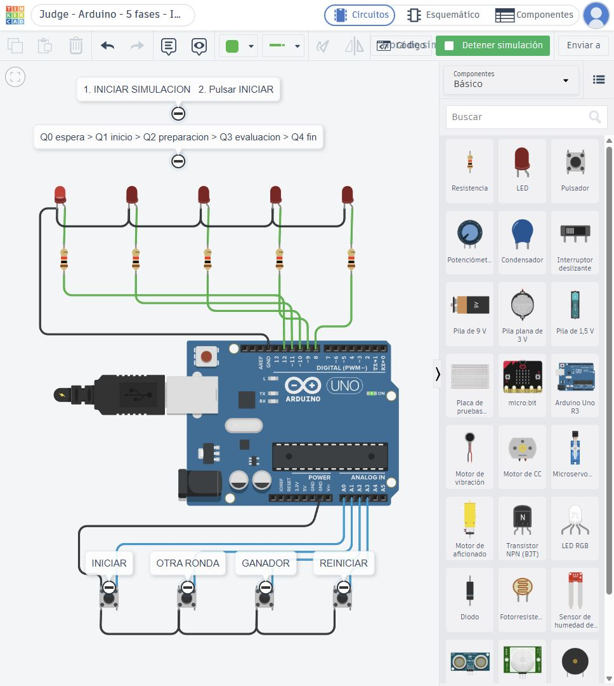

# Judge: controlador sencillo en Arduino

[Abrir el circuito en Tinkercad](https://www.tinkercad.com/things/i3ChqoUqULW/editel)

## Cómo usarlo

1. Pulsa **Iniciar simulación**. Se enciende la primera luz: Q0, espera.
2. Pulsa **INICIAR**. Las luces pasan por Q1 (1,5 segundos) y Q2 (2 segundos), hasta Q3.
3. En Q3 pulsa **OTRA RONDA** para repetir Q2 y volver a Q3, o **GANADOR** para llegar a Q4.
4. Pulsa **REINICIAR** para volver a Q0. Funciona desde cualquier fase.

Los botones están identificados en el montaje, de izquierda a derecha: INICIAR, OTRA RONDA, GANADOR y REINICIAR. No necesitas mover un reloj manual ni cargar otro programa: el código está guardado en el Arduino de Tinkercad.

## Las cinco luces, de izquierda a derecha

| Luz | Estado | Qué representa |
|---|---|---|
| 1 | Q0: espera | Listo para empezar. |
| 2 | Q1: inicio | Tiempo de inicialización. |
| 3 | Q2: preparación | Tiempo de preparación de la ronda. |
| 4 | Q3: evaluación | Espera el resultado de la ronda. |
| 5 | Q4: fin | La partida terminó. Permanece aquí hasta reiniciar. |

Este montaje demuestra **el controlador de las cinco fases para dos jugadores**. Los botones OTRA RONDA y GANADOR representan resultados ya calculados: no genera los números de los jugadores ni calcula sus acciones o puntajes.

## Conexiones

Hay un Arduino Uno, cinco LED con resistencias de 1 kohm y cuatro pulsadores. Verde identifica las salidas a los LED; azul, las entradas de los botones; negro, tierra común.

| Pin | Conexión |
|---|---|
| D12, D11, D10, D9, D8 | Q0, Q1, Q2, Q3, Q4, respectivamente. Cada pin pasa por una resistencia hacia el ánodo del LED. |
| GND | Cátodos de los LED y terminal 1 de los pulsadores. |
| A0 | Terminal 2 del pulsador INICIAR. |
| A1 | Terminal 2 del pulsador OTRA RONDA. |
| A2 | Terminal 2 del pulsador GANADOR. |
| A3 | Terminal 2 del pulsador REINICIAR. |

Los pulsadores usan INPUT_PULLUP: su lectura normal es HIGH y, al presionar, LOW. El programa filtra rebotes y reconoce una pulsación por cada presión.

El [programa editable](Controlador_Judge_Arduino.ino) también permite enviar I, N, G o R desde el monitor en serie. Para probarlo normalmente, basta con los botones.

