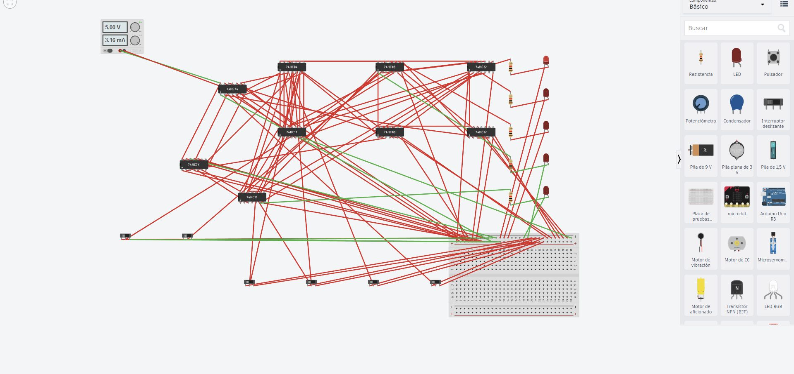

# Controlador de cinco fases en Tinkercad

[Abrir el circuito RNGPT++ - Controlador 5 fases J1 vs J2](https://www.tinkercad.com/things/6XiKYRBh2IK/editel)

Montado y probado el 4 de noviembre de 2026. Representa el controlador general para jugador 1 contra jugador 2 mediante compuertas y flip-flops, con alimentación de 5 V.

## Controles

Los dos interruptores de la fila superior son **S** y **P**, de izquierda a derecha. Los cuatro de la fila inferior son **F, V, R y CLK**, de izquierda a derecha. Los controles e indicadores tienen nombres para identificarlos al seleccionarlos con la simulación detenida.

| Interruptor | Significado |
|---|---|
| S | Solicitud de inicio, equivalente a Game B. |
| P | La preparación de la ronda terminó. |
| F | La ronda quedó resuelta y sus puntos ya se actualizaron. |
| V | Hay ganador. |
| R | Reinicio. |
| CLK | Reloj manual: mover de 0 a 1 y volver a 0 produce un pulso. |

**Izquierda = 0; derecha = 1.** Los cambios de estado ocurren al pasar CLK de 0 a 1. R también necesita un pulso: el reinicio es síncrono.

## Luces

Los cinco LED están a la derecha, de arriba hacia abajo:

| LED | Fase |
|---|---|
| L1 | Q0: espera. |
| L2 | Q1: inicialización. |
| L3 | Q2: preparación de ronda. |
| L4 | Q3: evaluación de ronda. |
| L5 | Q4: fin de partida. |

## Prueba rápida

Inicia la simulación si está detenida. Antes de probar, deja S, P, F, V, R y CLK en 0. En cada paso que indica **pulso**, mueve CLK a 1 y luego a 0.

| Paso | Qué hacer | Resultado |
|---|---|---|
| 1 | R = 1; pulso; después R = 0. | L1: espera. |
| 2 | S = 1; pulso. | L2: inicialización. |
| 3 | S = 0; pulso. | L3: preparación. |
| 4 | P = 1; pulso; después P = 0. | L4: evaluación. |
| 5 | F = 1 y V = 0; pulso; después F = 0. | L3: otra ronda. |
| 6 | P = 1; pulso; después P = 0. | L4: evaluación de la nueva ronda. |
| 7 | F = 1 y V = 1; pulso. | L5: fin de partida. |
| 8 | R = 1; pulso. Después deja todos los controles en 0. | L1: listo para empezar otra vez. |

P, F y V permiten probar manualmente las condiciones del controlador. La generación de números, los botones de ataque/esquiva y el cálculo de puntajes pertenecen a los bloques internos del juego y no están automatizados en este montaje.

## Verificación realizada

La simulación superó 12 comprobaciones: reinicio, permanencia en espera, inicio, inicialización, permanencia en preparación, entrada a evaluación, permanencia con F = 0 aunque V = 1, repetición sin ganador, nueva evaluación, victoria, permanencia en final y reinicio desde final.

Se contrastaron las 117 conexiones requeridas con el cableado visible, sin conexiones requeridas faltantes ni uniones adicionales entre redes que deban ser diferentes. La evidencia de las pruebas está en [verificacion_controlador.json](verificacion_controlador.json).

